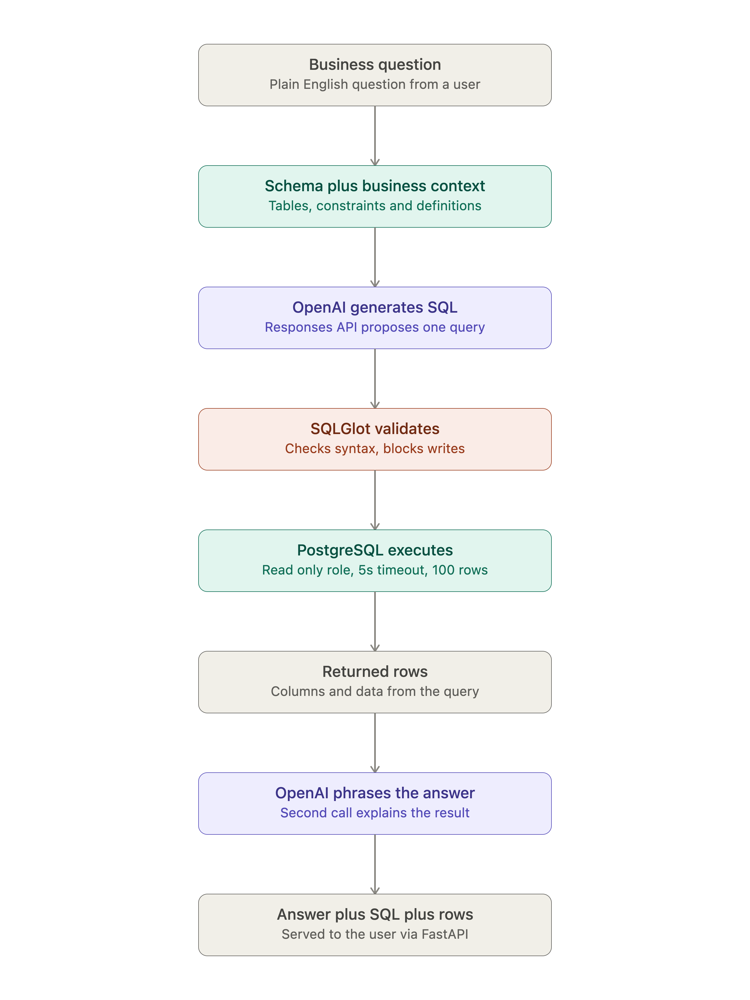

# Ops Copilot

Ask a business question in plain English and get the answer from a PostgreSQL database, with the SQL shown so the number can be checked.

It is a prototype built around a waste collection business: routes, drivers, customers, bin collections, invoices and supplier dockets. A language model writes the SQL, but it never touches the database. Every query is parsed and checked first, then run through a read only account.

All data is synthetic. No real company data was used.



## Example

Request to `POST /ask`:

```json
{ "question": "How many collections was done last month?" }
```

Response (shortened):

```json
{
  "status": "success",
  "answer": "740 collections were completed last month.",
  "validated_sql": "SELECT COUNT(*) AS collections_done_last_month FROM collections WHERE status = 'collected' AND collected_at >= DATE_TRUNC('MONTH', CURRENT_DATE - INTERVAL '1 MONTH') AND collected_at < DATE_TRUNC('MONTH', CURRENT_DATE) LIMIT 100;",
  "rows": [[740]]
}
```

Screenshots: [request](images/api_request.png), [response](images/api_response.png). A short screen recording is in [images/demo.mov](images/demo.mov).

## How it works

1. **Context.** The app reads the tables, columns, keys and check constraints from PostgreSQL and adds a set of written business rules (for example, what "collected" means).
2. **Generate.** An OpenAI model (Responses API) returns one SQL query, or `REFUSE:` with a reason.
3. **Validate.** SQLGlot parses the query into a syntax tree and the app applies the rules listed below.
4. **Execute.** The query runs as a read only database role with a timeout.
5. **Answer.** A second model call words the answer using only the returned rows. The API returns the answer, the SQL and the rows together.

## Safety controls

The generated SQL is treated as untrusted input.

| Control | Where |
| --- | --- |
| Exactly one statement, and it must be a read query | `validate_sql` |
| No write or admin operation anywhere in the tree, including inside a CTE | `validate_sql` |
| Only tables and views in the `public` schema | `validate_sql` |
| `LIMIT 100` added if missing, larger limits rejected | `validate_sql` |
| Role with `SELECT` only and `default_transaction_read_only = on` | `roles.sql` |
| 5 second statement timeout | database connection |

Known gaps: there is no column level or function level allowlist, the row limit does not cap the work the database does, and foreign key discovery assumes single column keys. This is defence in layers, not a full SQL sandbox.

## Data model

Six tables and one view, defined in [schema.sql](schema.sql).

| Object | Notes |
| --- | --- |
| `routes` | 5 routes |
| `drivers` | 6 drivers, one of whom leaves partway through |
| `customers` | 200, household or commercial. Names are not unique |
| `collections` | 4,917 lifts over about six months: collected, missed or contaminated |
| `invoices` | 1,146 monthly subscription invoices, some unpaid or late |
| `supplier_dockets` | 40 dockets, some not yet approved |
| `invoice_status` (view) | paid, open or overdue, derived from the dates |

Design decisions worth knowing:

- **Drivers are not a column on routes.** Drivers change, and updating a name on the route would rewrite who did every past collection. The driver and route are stored on each collection instead.
- **A missed collection has a NULL weight, not zero.** Zero is a real measurement and would pull down every average. A check constraint enforces it.
- **Invoices have no status column.** An invoice becomes overdue at midnight without any row changing, so status is calculated in a view.
- **Supplier dockets need human approval.** `approved_by` and `approved_at` must be set together. Until then the row is not trusted.

The constraints were tested by trying invalid inserts, such as a missed collection with a weight and a customer on a route that does not exist. Both were rejected.

`generate_data.py` fills the tables using a fixed random seed, so the data is the same on every run.

## Evaluation

I wrote ten business questions and their SQL by hand first ([queries.sql](queries.sql)). These are the ground truth. `evaluate.py` runs the reference query and the generated query for each question and compares the results, then runs three questions that must be refused.

| Round | Business correctness | Refusals | What changed |
| --- | --- | --- | --- |
| 1 | 5 / 10 | 3 / 3 | Schema only |
| 2 | 9 / 10 | 3 / 3 | Check constraints read automatically, business rules written out |
| 3 | 10 / 10 | 3 / 3 | Defined what "average collection weight" covers |

The round 1 failures were about meaning, not syntax. The first question returned 837 because the model counted every collection record. The correct answer was 740, because contaminated and missed lifts are not completed collections. Other failures mixed contaminated weights into tonnage and used supplier docket tonnes for customer collections.

Two numbers are reported for the final round, because they mean different things:

- **6 / 10 exact matches** from the automatic comparison.
- **10 / 10 correct** after I checked the other four by hand. They differed by extra columns, a different valid sort order, or more decimal places.

I stopped tuning the prompt after round 3. Ten questions is a small set and more tuning would only fit the prompt to those questions.

The three refusal tests are a delete request, a question about driver salaries (not in the database) and an update request.

## Running it

You need Docker, Python 3.9 or later and an OpenAI API key.

```bash
# 1. database
docker run --name opscopilot-db \
  -e POSTGRES_USER=postgres -e POSTGRES_PASSWORD=postgres \
  -e POSTGRES_DB=opscopilot -p 5432:5432 -d postgres:18

docker exec -i opscopilot-db psql -U postgres -d opscopilot < schema.sql

# 2. python
python3 -m venv .venv
source .venv/bin/activate
pip install -r requirements.txt

# 3. synthetic data
python generate_data.py

# 4. read only role (set a password in roles.sql first)
docker exec -i opscopilot-db psql -U postgres -d opscopilot < roles.sql

# 5. settings
cp .env.example .env        # then fill in the password and API key
set -a; source .env; set +a

# 6. run
uvicorn api:app --reload
```

Open http://127.0.0.1:8000/docs to try it. To run the evaluation:

```bash
python evaluate.py
```

The API can also run in a container with `docker build -t opscopilot .`, on the same Docker network as the database.

## Files

| File | Purpose |
| --- | --- |
| `schema.sql` | Tables, constraints, indexes and the view |
| `roles.sql` | Read only application role |
| `generate_data.py` | Synthetic data |
| `queries.sql` | Ten hand written reference queries |
| `text_to_sql.py` | Context, generation, validation, execution, answer |
| `evaluate.py` | Evaluation and refusal tests |
| `api.py` | FastAPI app: `/`, `/health`, `/ask` |

## Not built yet

- Reading supplier dockets from PDF. The table and approval rule exist; the extraction does not.
- Deployment to AWS. The plan is a container service, a managed PostgreSQL database and a cache for validated SQL ([diagram](images/planned_aws_pipeline.png)).
- Login and per user permissions.
- Automated tests for the validator, and a larger evaluation set.

## Author

Ryan Biju Joseph, September 2026
